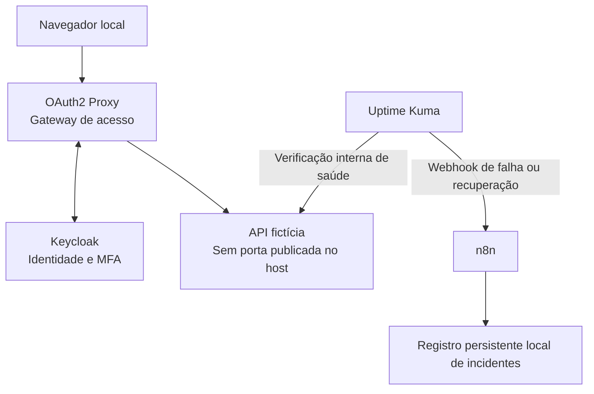

# SecureOps Lab

Laboratório pessoal de operações de TI e segurança para praticar controle de acesso baseado em identidade, monitoramento e resposta automatizada a incidentes.

O projeto simula a operação de um serviço interno: somente usuários autorizados podem acessá-lo e, quando ele fica indisponível, um fluxo automatizado registra o incidente e acompanha sua recuperação.

> **Status:** Fundação Local concluída. API, imagens, Compose, saúde, rede interna, ausência de portas publicadas e ciclo de parada/recuperação validados; 35 testes aprovados via Compose. Identidade, monitoramento e automação ainda não foram implementados. A arquitetura abaixo descreve o resultado pretendido.

## Objetivo

Construir uma prova de conceito pequena, reproduzível e demonstrável, conectando desenvolvimento de software a práticas de operações e segurança:

- Autenticação, autorização e autenticação multifator (MFA).
- Menor privilégio e proteção contra acesso direto à aplicação.
- Redes entre containers e exposição mínima de portas.
- Monitoramento de disponibilidade e diagnóstico de falhas.
- Integração por webhooks e automação operacional.
- Registro, deduplicação e encerramento de incidentes.
- Documentação de arquitetura, testes e procedimentos de recuperação.

## Premissas

- **Gratuito:** sem contratação de cloud, domínio, APIs pagas ou serviços externos obrigatórios.
- **Local:** execução no próprio computador, com Docker Compose.
- **Isolado:** somente aplicação, contas e dados fictícios do laboratório.
- **Educacional:** não utiliza sistemas, credenciais ou dados de empresas.
- **Escopo de fim de semana:** priorizar um fluxo completo e compreensível em vez de uma infraestrutura extensa.
- **Sem exposição pública:** não abrir portas no roteador nem criar túneis públicos.

O laboratório usa recursos do computador e não pretende reproduzir a disponibilidade ou a segurança de um ambiente de produção.

## Cenário

Uma equipe de operações utiliza uma aplicação interna fictícia. A operadora deve se autenticar com MFA e possuir autorização para acessar o serviço. Uma pessoa autenticada, mas sem permissão, deve ser bloqueada.

Enquanto isso, um monitor verifica a saúde da aplicação pela rede interna. Uma indisponibilidade gera um evento para a automação, que registra o incidente sem duplicá-lo. Quando o serviço volta, a recuperação é registrada com a duração observada.

## Arquitetura proposta



A Fundação Local usa a rede `service` interna, sem volumes nem portas publicadas. Redes e portas das próximas entregas serão definidas nas respectivas especificações. O acesso de usuário deverá passar pelo gateway; interfaces administrativas deverão ficar restritas ao computador local.

### Tecnologias previstas

| Tecnologia | Responsabilidade |
| --- | --- |
| Node.js + TypeScript | Serviço fictício com página simples e endpoint de saúde |
| Keycloak | Gerenciar usuários, grupos e MFA com TOTP |
| OAuth2 Proxy | Integrar autenticação OIDC e restringir o acesso à aplicação |
| Uptime Kuma | Verificar disponibilidade e emitir eventos |
| n8n Community, self-hosted | Processar eventos e automatizar o ciclo de incidente |
| Docker Compose | Orquestrar serviços, redes e volumes locais |

O mecanismo de persistência dos incidentes será escolhido nas especificações, priorizando simplicidade, consulta e reprodução dos testes.

O uso pessoal local do n8n é gratuito, mas a ferramenta possui licença própria. O Docker Desktop também permite uso pessoal gratuito conforme seus termos. Não é necessário contratar funcionalidades comerciais desses produtos.

## Funcionalidades planejadas

### 1. Acesso baseado em identidade

- Criar uma conta fictícia autorizada e outra sem autorização.
- Configurar autenticação OIDC entre Keycloak e gateway.
- Exigir MFA com TOTP para o acesso demonstrado.
- Aplicar uma política explícita de autorização no gateway.
- Comprovar que autenticação bem-sucedida não implica autorização.
- Impedir acesso direto à API por uma porta publicada no host.

A forma de representar e validar permissões por grupos ou claims será detalhada na especificação de identidade.

### 2. Monitoramento de disponibilidade

- Disponibilizar um endpoint `/health` sem dados sensíveis.
- Configurar verificações periódicas pela rede interna do laboratório.
- Identificar indisponibilidade e recuperação.
- Permitir uma simulação controlada de falha ao parar o container da API.

O monitoramento interno não comprova a saúde de todo o caminho percorrido pelo usuário. Falhas no gateway, na autenticação ou no navegador podem existir mesmo com a API saudável.

### 3. Resposta automatizada a incidentes

- Receber eventos do monitor por webhook.
- Validar e normalizar os dados recebidos.
- Registrar serviço afetado, estado, horários e identificador do incidente.
- Evitar múltiplos incidentes abertos para a mesma indisponibilidade.
- Encerrar o incidente após a recuperação e calcular sua duração observada.
- Manter registros persistentes e consultáveis sem integrações externas obrigatórias.

A autenticação do webhook, a persistência e o tratamento de eventos repetidos ou fora de ordem serão definidos nas especificações.

### 4. Documentação operacional

- Documentar arquitetura e decisões técnicas.
- Registrar evidências dos testes sem expor credenciais ou tokens.
- Escrever um runbook de diagnóstico e recuperação.
- Produzir um relato curto do incidente simulado: impacto, linha do tempo, causa e melhorias.

## Demonstrações esperadas

| Cenário | Resultado esperado |
| --- | --- |
| Acesso sem sessão válida | O gateway exige autenticação |
| Login da operadora | MFA exigido e acesso permitido após autorização |
| Login da visitante | Identidade autenticada, mas acesso à aplicação negado |
| Tentativa de acesso direto pela porta da API no host | Aplicação não acessível por esse caminho |
| Parada do container da API | Monitor detecta falha e automação registra incidente |
| Repetição do evento de falha | Nenhum incidente aberto duplicado |
| Retorno da API | Monitor detecta recuperação e automação encerra o incidente |

Esses cenários são metas de validação, não resultados já obtidos.

## Segurança e limites

- Não versionar senhas, tokens, cookies de sessão, sementes TOTP ou arquivos `.env` com valores reais.
- Fornecer futuramente um `.env.example` apenas com nomes e valores fictícios seguros.
- Não reutilizar credenciais pessoais ou corporativas.
- Não publicar interfaces administrativas na internet.
- Executar testes somente contra os serviços do próprio laboratório.
- Manter o monitor e o receptor de eventos fora do container da API, para que a falha simulada não derrube todo o fluxo.
- Não assumir que volumes locais fornecem backup, alta disponibilidade ou proteção contra adulteração.

### O que o laboratório não comprova

- **ZTNA completo:** gateway com identidade e MFA demonstra alguns princípios de Zero Trust, mas não equivale a uma plataforma ZTNA com avaliação de dispositivo e políticas contínuas.
- **Firewall completo:** redes Docker e ausência de portas publicadas reduzem exposição, mas não substituem uma política de firewall validada.
- **Proteção de produção:** o projeto não inclui, por padrão, alta disponibilidade, gestão completa de segredos, auditoria imutável ou endurecimento de todos os componentes.
- **SSO entre múltiplas aplicações:** uma integração OIDC isolada não demonstra, sozinha, uma experiência de SSO entre vários serviços.
- **Segurança de transporte pronta:** a configuração de HTTPS local e as exceções eventualmente necessárias ao desenvolvimento precisam ser explicitadas antes da implementação.

## Fora do escopo inicial

- Infraestrutura cloud, domínio próprio e Cloudflare.
- Integração obrigatória com Zendesk, e-mail ou mensageria externa.
- Kubernetes, SIEM, antivírus corporativo e múltiplos ambientes.
- Interface elaborada ou aplicação financeira real.
- Recuperação automática com ações privilegiadas.
- IA e envio de logs para provedores externos.

### Extensão opcional: WAF

Após validar o fluxo principal, poderá ser avaliado um proxy com ModSecurity e OWASP Core Rule Set para observar requisições permitidas, bloqueios e falsos positivos.

Essa extensão deverá ter especificação própria e não será considerada implementada apenas pela presença de um proxy ou de uma regra didática.

## Execução

### Pré-requisitos, build e testes

A partir da raiz do projeto, no PowerShell, com Docker em modo Linux:

- Ambiente validado: Docker Engine `28.5.1`, Compose `v2.40.2-desktop.1`, Linux `amd64` via Docker Desktop.
- Versões da aplicação: Node `24.22.1`, TypeScript `5.9.3`, `@types/node` `24.19.2`.
- Sem necessidade de portas livres no host. Na coleta local, a API usou aproximadamente 19 MiB de memória; isso é um snapshot, não requisito mínimo ou dimensionamento do laboratório completo. O daemon dispunha de 12 CPUs e 7,61 GiB totais; consumo máximo de build e espaço necessário não foram medidos.

```powershell
docker compose config --quiet
docker compose --profile tools run --build --rm api-test
docker compose build api
```

Não é necessário instalar Node no host nem criar `.env`. O build inicial requer internet para obter a imagem Node `24.22.1-bookworm-slim` e instalar os pacotes pelo lockfile. O container `api-test` compila TypeScript e executa 35 testes com `network_mode: none`, sem mounts nem portas publicadas, e é removido ao terminar. Confira `$LASTEXITCODE`: o resultado esperado é `0` em cada comando; não avance se houver falha.

A imagem `secureops-api:0.1.0` contém o JavaScript da aplicação e o probe, sem copiar compilador, testes ou `node_modules` do build. A API executa como `node`. O serviço `probe` reutiliza essa imagem local: execute `docker compose build api` antes de usá-lo. Apenas `api` tem build de runtime, evitando duas exportações concorrentes para a mesma tag. `api-test` tem imagem separada.

Código: [`apps/api/src`](apps/api/src). Testes: [`apps/api/test`](apps/api/test). Resultados e limitações: [evidências](docs/evidence/01-local-foundation.md).

### Iniciar, verificar e diagnosticar

Após o build, inicie somente a API e espere até 60 segundos pela saúde:

```powershell
docker compose up -d --wait --wait-timeout 60 api
docker compose --profile tools run --rm --no-deps probe
docker compose logs --no-color api
```

O probe consulta `http://api:3000/health`, exige `200` e o JSON esperado e limita a requisição completa a 2 segundos. O health check usa o mesmo script contra `127.0.0.1` dentro do container. Os auxiliares ficam no profile `tools` e não são serviços permanentes; não dependem do início automático da API.

A API não tem porta publicada, portanto não há endereço para abri-la no navegador do host. HTTP interno não cifra o tráfego fictício; a máquina e o Docker pertencem à base de confiança. A ausência de publicação não comprova isolamento absoluto. Identidade e acesso pelo gateway pertencem à próxima entrega.

### Simular falha e recuperar

```powershell
docker compose stop api
docker compose --profile tools run --rm --no-deps probe
$probeExit = $LASTEXITCODE
if ($probeExit -ne 1) { throw 'Esperado probe com codigo 1 enquanto API esta parada' }
docker compose up -d --wait --wait-timeout 60 api
docker compose --profile tools run --rm --no-deps probe
docker compose stop api
```

A falha intermediária (`probe_failed`, código `1`) é esperada; antes e depois dela, o probe deve retornar `probe_succeeded`, código `0`. `--no-deps` impede que o teste negativo inicie serviços. O limite HTTP é de 2 segundos; o tempo total do comando inclui criar/remover o container.

`up --wait` também retoma o container parado sem recriá-lo quando a configuração/imagem não mudou. `docker compose start api` é alternativa, mas não aguarda saúde: consulte o health check antes de testar. A última linha deixa a API parada; não remove container, imagem ou rede. Não há volumes nesta entrega. Não execute limpeza ampla ou `down -v`.

Para inspecionar bindings, usuário efetivo, redes e logs de saúde, siga o [runbook da Fundação Local](docs/runbooks/local-foundation.md). Esse procedimento complementa o probe: sucesso interno não comprova ausência de publicação de portas. Os resultados medidos e os limites estão nas [evidências](docs/evidence/01-local-foundation.md).

## Próximos passos

1. Revisar a [SPEC](docs/features/02-identity-access/SPEC.md) e o [PLAN](docs/features/02-identity-access/PLAN.md) propostos de Identidade e acesso, incluindo as decisões D01–D03 de transporte, nomes OIDC e persistência.
2. Autorizar preparação/implementação de identidade somente após resolver essas decisões; a proposta de HTTP/cookies de desenvolvimento ainda não está aprovada.
3. Seguir para monitoramento, automação e demonstração integrada conforme o [roadmap](docs/roadmap.md).

## Resultado pretendido

Demonstrar, de ponta a ponta, que um serviço pode ter acesso controlado, falhas detectáveis e tratamento de incidentes automatizado — com decisões e limitações explicadas de forma clara.
