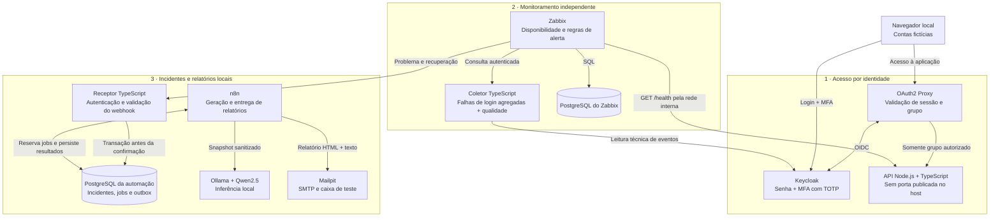

# SecureOps Lab

**Um laboratório local que conecta acesso por identidade, monitoramento, incidentes persistentes e relatórios com IA.**

O SecureOps Lab simula a operação de uma aplicação interna fictícia. Uma pessoa precisa se autenticar com MFA e pertencer ao grupo autorizado para acessá-la. Em paralelo, o Zabbix acompanha disponibilidade e falhas de login; eventos do monitor alimentam uma automação que registra incidentes, correlaciona recuperações e gera relatórios HTML com IA local, enviados para uma caixa de e-mail de teste.

O objetivo é aprender e demonstrar conceitos de operações e segurança com decisões técnicas explicáveis, sem contratar serviços, usar dados de empresas ou expor o laboratório na internet.

> **Estado do projeto:** identidade e monitoramento validados; fluxo mínimo de incidentes → IA → HTML → SMTP local demonstrado de ponta a ponta. É uma **prova de conceito educacional**, não uma solução de produção. A IA apresentou afirmações causais sem evidência em alguns ensaios; seus textos exigem revisão humana. O aceite completo da automação permanece parcial: [resultados e pendências](docs/evidence/04-acceptance-matrix.md).

## Comece por aqui

- **Entender a solução:** [fluxo completo](#como-o-fluxo-funciona) e [componentes](#tecnologias-e-responsabilidades).
- **Ver a demonstração:** [roteiro de 5 minutos](docs/runbooks/interview-demo.md).
- **Executar na sua máquina:** [pré-requisitos e instalação](#como-executar).
- **Examinar as decisões:** [arquitetura](docs/architecture.md), [roadmap](docs/roadmap.md) e [evidências](docs/evidence/).

## O problema representado

Imagine um serviço interno utilizado por uma equipe de operações:

1. A **operadora** deve entrar com senha e um código temporário do autenticador — MFA com TOTP.
2. A **visitante**, embora tenha uma identidade válida e também use MFA, não pertence ao grupo autorizado e deve receber **403**.
3. Se a aplicação parar, a falha precisa ser detectada sem depender do próprio container que caiu.
4. Problema e recuperação precisam formar um único incidente, com horários e duração observada, mesmo se um evento for repetido.
5. O incidente deve produzir um relatório consultável, com fatos separados de hipóteses e sugestões de investigação.

**Autenticação responde “quem é você?”; autorização responde “você pode acessar?”. Monitoramento e automação observam o serviço por caminhos independentes do login.**

## Como o fluxo funciona



### Do evento ao relatório

1. **O Zabbix detecta o evento.** Além do teste HTTP interno, acompanha falhas repetidas de autenticação e problemas na qualidade da coleta. Falta de dados não é tratada como zero falhas.
2. **Uma action restrita envia o webhook.** Apenas as condições aprovadas do laboratório participam; não há comandos de correção automática.
3. **O receptor valida e confirma após o commit.** O PostgreSQL mantém a identidade dos eventos, evita duplicações e correlaciona problema e recuperação para calcular a duração.
4. **O n8n processa um job persistido.** A geração do relatório é assíncrona: indisponibilidade da IA ou do n8n não impede o registro do incidente.
5. **O Ollama gera o texto analítico.** Recebe um resumo estruturado de fatos, sem logs brutos nem segredos. A IA não decide o estado do incidente.
6. **Um template fixo monta o HTML.** Os fatos vêm do banco e as strings são escapadas. O envio é registrado em uma **outbox**, uma fila persistente de mensagens.
7. **O Mailpit recebe o e-mail local.** É uma caixa fictícia de teste, não um serviço de envio para endereços pessoais ou externos.

O diagrama representa a arquitetura, não o estado dos containers em tempo real. Para redes, fronteiras e decisões detalhadas, consulte a [arquitetura](docs/architecture.md).

## Tecnologias e responsabilidades

| Componente | Versão de referência | Papel no laboratório |
| --- | --- | --- |
| Node.js + TypeScript | 24.22.1 / 5.9.3 | API fictícia, coletor de eventos e receptor de webhooks |
| Keycloak | 26.8.1 | Identidades, grupos e MFA com TOTP |
| OAuth2 Proxy | 7.15.5 | Integração OIDC e autorização pelo grupo exato `/secureops-operators` |
| Zabbix | 7.0.32 LTS | Testes de disponibilidade, itens, triggers e eventos problem/recovery |
| PostgreSQL | 17.11 | Persistência do monitoramento e da automação em instâncias separadas |
| n8n | 2.44.7 | Workflows de geração e entrega dos relatórios |
| Ollama + Qwen2.5 | 0.40.11 / 1.5B Instruct Q4_K_M | Inferência local para o texto analítico |
| Mailpit | 1.32.0 | SMTP autenticado e visualização dos e-mails de teste |
| Docker Compose | Ambiente validado com v2.40.2 | Serviços, redes, limites de recursos e volumes locais |

Imagens e dependências têm versões explícitas; digests e justificativas ficam nas configurações e especificações. O uso pessoal local não exige funcionalidades comerciais, mas cada ferramenta mantém seus próprios termos de licença.

## O que já foi demonstrado

| Área | Resultado observado | Evidências |
| --- | --- | --- |
| Fundação | API com health check, execução não root e sem porta publicada no host | [Entrega 01](docs/evidence/01-local-foundation.md) |
| Identidade | Operadora com MFA acessa; visitante autenticada recebe 403; gateway rejeita tokens/cookies inválidos nos testes | [Entrega 02](docs/evidence/02-identity-access.md) |
| Monitoramento | Queda/retorno da API, limiar de falhas de login e alerta técnico de coleta; histórico preservado nos ensaios | [Entrega 03](docs/evidence/03-monitoring.md) |
| Incidentes | Ciclos reais distintos, encerramento correlacionado e replay concorrente sem criar novos registros | [Entrega 04](docs/evidence/04-incident-automation.md) |
| Relatórios | Inferência local real, HTML persistido, aceite SMTP e mensagens verificadas no Mailpit | [Matriz de aceite](docs/evidence/04-acceptance-matrix.md) |
| Falhas e retomada | N8n parado manteve incidente/job; IA offline esgotou tentativas; SMTP offline deixou envio desconhecido sem reenvio cego | [Resultados e limites](docs/evidence/04-incident-automation.md) |

**Os testes não são todos equivalentes:** há suites isoladas, ensaios com containers reais e verificações de navegador relatadas pela autora. A documentação identifica a origem e os limites de cada evidência. Fluxo funcional não significa que todos os critérios de endurecimento estejam concluídos.

## Interfaces locais

As URLs abaixo só funcionam **na máquina em que o laboratório estiver instalado e iniciado**. Não há demonstração pública hospedada.

| Interface | URL | Uso |
| --- | --- | --- |
| Aplicação protegida | `http://app.localhost:4180/` | Acesso pelo gateway; contas fictícias com MFA |
| Identidade | `http://keycloak.localhost:8080/` | Autenticação e administração local do Keycloak |
| Monitoramento | `http://localhost:8081/` | Painel privado do Zabbix |
| Automação | `http://127.0.0.1:5678/` | Editor autenticado do n8n |
| Caixa de e-mail | `http://127.0.0.1:8025/` | Relatórios recebidos no Mailpit, com autenticação |

Os bindings dessas interfaces usam loopback (`127.0.0.1`). API, receptor, bancos, Zabbix server, coletor, Ollama e SMTP não publicam portas no host. As contas administrativas do Zabbix, n8n e Mailpit são próprias de cada serviço; **não estão todas integradas ao login da aplicação**.

Não há senhas de demonstração no repositório. Elas são geradas ou cadastradas localmente; nunca reutilize credenciais pessoais.

## Como executar

### Pré-requisitos

- Docker com containers Linux e Docker Compose. Ambiente validado em Windows/PowerShell, Docker Engine 28.5.1 e Compose v2.40.2 via Docker Desktop.
- Recursos para executar a stack e a inferência local. O ambiente de validação tinha 12 CPUs e aproximadamente 7,6 GiB disponíveis ao Docker; isso **não é um requisito mínimo aferido**. Os pesos do modelo ocupam aproximadamente 986 MB, além das imagens e dos volumes.
- Portas de loopback 4180, 8080, 8081, 5678 e 8025 livres para o laboratório completo.
- Internet na instalação inicial para imagens, dependências e modelo. A inferência dos relatórios usa o modelo local, não uma API de IA em nuvem.

Não é necessário instalar Node.js no host para executar a API e seus testes via Docker. Os inicializadores de segredos usam recursos do Windows/PowerShell; instalação em outro sistema exige adaptação e não foi validada de ponta a ponta.

### 1. Conhecer a base: API e testes

Na raiz de uma cópia local do repositório:

```powershell
docker compose config --quiet
docker compose --profile tools run --build --rm api-test
docker compose build api
docker compose up -d --wait --wait-timeout 60 api
docker compose --profile tools run --rm --no-deps probe
```

Execute um comando por vez e confirme `$LASTEXITCODE` igual a `0` antes de continuar. O teste compila a aplicação e executa 35 testes em container sem rede; o probe verifica o health check pela rede interna. **Esses comandos iniciam somente a fundação, não o laboratório completo.** A API não fica disponível diretamente no navegador.

### 2. Montar o laboratório completo, por etapas

Siga os runbooks nesta ordem; não basta executar um único `docker compose up`:

| Etapa | Procedimento | Configurações importantes |
| --- | --- | --- |
| Fundação | [API e execução local](docs/runbooks/local-foundation.md) | Build, health check, redes e diagnóstico |
| Identidade | [Identidade e acesso](docs/runbooks/identity-access.md) | Segredos exclusivos, contas fictícias, grupo autorizado e cadastro manual de TOTP |
| Monitoramento | [Zabbix e coletor](docs/runbooks/monitoring.md) | Banco, host, itens/triggers, permissões técnicas e painel |
| Automação | [Incidentes e relatórios](docs/runbooks/incident-automation.md) | Banco separado, migrações, allowlist, modelo local, credenciais e workflows |
| Demonstração | [Roteiro integrado](docs/runbooks/interview-demo.md) | Percurso curto e ciclo opcional de falha/recuperação |

**Reprodução tem passos manuais.** O cadastro TOTP, as contas das interfaces e os vínculos de credenciais não são distribuídos com o código. IDs de objetos do Zabbix e mapeamentos da action dependem da instância; devem ser conferidos, não copiados cegamente. A instalação completa em uma segunda máquina ainda não foi validada.

### 3. Retomar uma instalação existente

Use os procedimentos de retomada dos runbooks, preservando volumes, chaves e credenciais. Os inicializadores em `scripts/Initialize-*.ps1` são para instalação nova e recusam sobrescrever arquivos existentes — **não são comandos de reset**.

Não use `down -v`, `prune` ou `--remove-orphans` para resolver um aviso ou repetir uma demonstração. Parar a API pode gerar um incidente real no próprio laboratório; siga o roteiro que a restaura ao terminar.

## Decisões que importam

- **Autorização no gateway:** estar autenticado não basta; o grupo autorizado é conferido antes de encaminhar a requisição à API.
- **Monitoramento fora da aplicação:** parar a API não para o monitor nem o receptor de eventos.
- **Receptor separado do n8n:** um candidato de ingestão direta no n8n reteve headers de entrada nos testes. O receptor mínimo evita encaminhar esses segredos à automação de relatórios.
- **Consistência no banco:** identidade dos eventos, transações e constraints sustentam a deduplicação; não se usa o histórico de execuções do n8n como banco de incidentes.
- **Relatório assíncrono:** IA e SMTP ficam fora da confirmação do webhook, permitindo registrar incidentes mesmo quando a geração está indisponível.
- **Falha de envio explícita:** uma aceitação SMTP ambígua vira `delivery_unknown`, sem reenvio automático. Aceite SMTP não comprova leitura humana nem entrega fora do host.

## Segurança e limitações

- Apenas serviços, contas e dados fictícios do próprio laboratório. Sem testes em sistemas externos, túneis públicos ou portas abertas no roteador.
- Senhas, tokens, cookies, sementes TOTP e arquivos locais de credenciais não devem ser versionados nem incluídos em logs, capturas ou exports. A pasta `.local/` é ignorada pelo Git, mas continua sensível na máquina.
- HTTP e SMTP locais usam exceções de transporte documentadas, sem confidencialidade de TLS. Host e Docker fazem parte da base de confiança; redes Docker não garantem isolamento absoluto nem bloqueio geral de saída.
- A IA pode alucinar, inclusive afirmar causas sem evidência. Validação de JSON e escape de HTML protegem formato e renderização, **não a verdade do texto**. Os relatórios exigem avaliação humana.
- Não há ações corretivas automáticas, administração de serviços pela IA, envio de logs a provedores de IA ou SMTP externo configurado.
- Volumes fornecem persistência, não backup, alta disponibilidade ou auditoria imutável. Há pendências de retry/reconciliação SMTP e de validação integrada descritas na matriz.
- O laboratório não é uma implementação completa de ZTNA, SIEM ou segurança de produção. Um alerta de login é sinal de triagem, não prova de ataque; API saudável não comprova todo o caminho do usuário.

## Organização do repositório

```text
apps/                   API, coletor de identidade e receptor de incidentes
infra/                  Configurações, migrações, workflows e testes de integração
scripts/                Inicialização, verificações e ensaios operacionais
docs/
  architecture.md       Responsabilidades, fronteiras e decisões
  roadmap.md            Entregas e evolução do projeto
  features/             Especificações e planos de execução
  runbooks/             Instalação, operação e demonstração
  evidence/             Resultados sanitizados e limitações dos testes
compose*.yaml           Composição modular dos serviços locais
```

O arquivo [docs/topology.html](docs/topology.html) oferece mapas visuais detalhados de **identidade e monitoramento**. No GitHub, ele abre como código: baixe ou abra a cópia local no navegador. Para o fluxo atual de automação, use o diagrama deste README e a arquitetura; não trate a topologia HTML como representação atualizada de toda a entrega 04.

## Evolução

O próximo passo não é ampliar a infraestrutura, mas consolidar o que foi demonstrado: revisão semântica da IA, caminhos de falha/retry, validação integrada de autenticação e reprodução em outra instalação. O [roadmap](docs/roadmap.md) registra a evolução; a [matriz de aceite](docs/evidence/04-acceptance-matrix.md) diferencia o fluxo funcional dos requisitos ainda pendentes.

**Em uma frase:** este projeto demonstra como controlar quem acessa um serviço, detectar falhas, manter incidentes consistentes e produzir relatórios locais — explicando também onde termina a evidência e começa uma hipótese.
