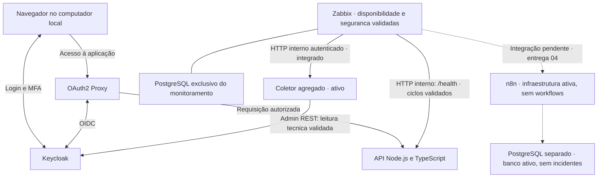

# Arquitetura do SecureOps Lab

> Status: Fundação, Identidade e Monitoramento concluídos. Entrega 04 em implementação inicial: infraestrutura n8n/PostgreSQL exclusivo/Ollama/Qwen2.5/Mailpit ativa, smokes independentes aprovados; workflow de incidentes/relatórios e integração Zabbix ainda pendentes. Decisões compartilhadas aqui; detalhes executáveis nas SPECS.

## 1. Restrições

- Execução no computador pessoal, com Docker Compose e containers Linux.
- Sem cloud, domínio, serviços pagos ou integrações externas obrigatórias em runtime.
- Downloads de imagens e dependências e o uso de IA no desenvolvimento podem exigir internet; isso não significa que a instalação inicial funcione offline.
- Apenas contas e dados fictícios; nenhuma conexão com sistemas corporativos.
- Escopo reduzido: um serviço protegido e um ciclo completo de incidente.

## 2. Componentes e fluxos



| Componente | Responsabilidade | Não deve fazer |
| --- | --- | --- |
| API | Representar o serviço interno e responder ao health check | Gerenciar credenciais ou executar recuperação privilegiada |
| OAuth2 Proxy | Validar sessão e aplicar autorização antes de encaminhar à API | Liberar acesso apenas porque o login funcionou |
| Keycloak | Autenticar identidades e exigir TOTP no fluxo definido | Ser apresentado como uma plataforma ZTNA completa |
| Zabbix | Detectar disponibilidade, avaliar agregado de falhas de login e registrar problemas/recuperações | Ser SIEM ou prova de ataque confirmado; confundir ausência de coleta com saúde |
| PostgreSQL do Zabbix | Persistir configuração, histórico e eventos do monitoramento | Ser apresentado como banco da futura automação sem decisão na SPEC 04 |
| Coletor interno, ativo | Ler eventos com client técnico view-events e retornar agregado sanitizado | Usar administrador/gateway, alterar usuários ou expor logs/tokens brutos |
| n8n | Validar eventos e coordenar o ciclo de incidentes | Controlar o Docker ou executar ações privilegiadas |
| Persistência de incidentes | Manter estado consultável após reinícios | Ser confundida com o histórico temporário de execuções do n8n |

A [SPEC 04](features/04-incident-automation/SPEC.md) define PostgreSQL exclusivo da automação, sem reutilizar zabbix-db, com bancos/papéis distintos para metadados n8n e incidentes/relatórios. Sob autorização da autora para escolher versões/modelo e iniciar, infraestrutura e modelo local foram instalados. Ollama e SMTP não publicam portas; editor n8n e UI Mailpit em loopback. Transação de incidentes/workflows/action/HTML ainda não implementados. Redes, transporte, ACK após commit e limites de replay ficam centralizados na SPEC; linhas tracejadas continuam indicando integração pendente.

API, Keycloak e gateway pertencem à entrega 02 concluída. Overlay Zabbix/coletor executando com integração validada no PLAN/evidências 03. Kuma nunca foi instalado; n8n agora executa sem workflows. Problema único do Zabbix não comprova deduplicação da automação futura; smoke de IA/SMTP não equivale a relatório integrado.

## 3. Acesso e identidade

Fluxo esperado:

1. O navegador solicita a aplicação pelo gateway.
2. Sem sessão válida, o gateway inicia autenticação OIDC no Keycloak.
3. O Keycloak autentica a conta e exige MFA com TOTP.
4. O gateway valida a resposta OIDC e a permissão por grupo ou claim.
5. A conta autorizada acessa a API; a conta sem permissão recebe negação.

Contas previstas: uma operadora autorizada e uma visitante autenticável, mas sem autorização. Ambas devem permitir comprovar a separação entre identidade e permissão.

A [SPEC 02](features/02-identity-access/SPEC.md) detalha realm/client, claims, autorização, cookies, logout e TOTP. Keycloak/gateway executando; autora confirmou operadora permitida, visitante negada, OTP, sessão aproximada de cinco minutos, logout e retomada. Harness isolado do mesmo binário valida audiência/assinatura/nonce/state/grupos/cookie, sem alterar o gateway principal. Origem/limites na seção 19 das [evidências](evidence/02-identity-access.md). Não usar redirects amplos nem ignorar validações de emissor.

### Endereçamento OIDC

O navegador e o gateway em container precisam alcançar os endpoints do Keycloak mantendo coerência do emissor (`issuer`). `localhost` dentro de um container não aponta para o host nem para outro serviço.

A solução de nomes, hostname e descoberta OIDC deve ser definida e testada explicitamente na SPEC de identidade. Não basta trocar URLs até o login aparecer.

## 4. Rede e exposição

Topologia lógica proposta:

| Rede | Participantes | Finalidade |
| --- | --- | --- |
| Identidade | Gateway, Keycloak e coletor no modo completo | Comunicação OIDC e leitura técnica de eventos |
| Serviço | Gateway, API e monitor | Encaminhamento e health check |
| Monitoring, interna | Banco, server, frontend e coletor | Comunicação do monitoramento e métricas agregadas |
| Operations, bridge não interna | Frontend Zabbix | Publicação do painel exclusivamente em loopback |
| Eventos, futura | Zabbix e n8n, desenho a definir na entrega 04 | Integração ainda não implementada |

A rede `identity` é bridge **não interna**, após aprovação D04; `service` permanece interna, API somente nela e sem porta. M-D03 acrescenta `monitoring` interna e `operations` não interna para o frontend; coletor participa de `monitoring` e `identity`, sem acesso a `service`. Essas bridges permitem rota de saída: não alegar egress bloqueado. Não realizar teste contra sistemas externos. Fronteiras completas na [SPEC 03](features/03-monitoring/SPEC.md); identidade preservada conforme [SPEC 02](features/02-identity-access/SPEC.md).

- A API não publica porta no host.
- Gateway, Keycloak e interfaces administrativas necessárias publicam portas somente em loopback.
- As portas exatas serão definidas após verificar conflitos no computador.
- O n8n não precisa ter seu webhook exposto na internet: o monitor o acessa pela rede Docker.
- Credenciais do webhook e painéis administrativos devem continuar protegidos mesmo em ambiente local.

A máquina hospedeira, seus administradores e o daemon Docker fazem parte da base de confiança. Ausência de porta publicada não é isolamento contra quem controla o host ou consegue entrar na rede Docker.

## 5. Transporte local

HTTP estritamente local, cookies sem Secure onde necessário e modo de desenvolvimento aprovados na [SPEC 02](features/02-identity-access/SPEC.md). Cookie de sessão do gateway sem Secure confirmado pela autora. Chrome headless observou cookies de pré-login Keycloak com Secure/SameSite=None em `.localhost`; isso não transforma HTTP em TLS nem garante o mesmo comportamento em outros navegadores. Cookies autenticados Keycloak não inspecionados pelo agente. Validações OIDC mantidas; SSL do realm continua `external`.

A solução deve registrar URLs, confiança de certificados, comportamento dos cookies e eventuais exceções. Caso HTTP seja escolhido para a PoC, não apresentar o tráfego como cifrado, não usar credenciais reais e documentar o limite local. Não espalhar desativações de TLS ou de verificação de tokens como atalho.

M-D02 aprova frontend em `http://localhost:8081`, somente `127.0.0.1`, e transporte local sem TLS entre componentes de monitoramento. PostgreSQL usa protocolo próprio com senha SCRAM nas conexões TCP, não HTTP; o socket local usa peer com usuário postgres. Credenciais exclusivas e contas fictícias, host/daemon confiáveis. Autora confirmou manualmente sessão/cookies e login após recriação; origem, atributos e limites na seção 11 das [evidências 03](evidence/03-monitoring.md). Isso não comprova confidencialidade de transporte ou configuração adequada para produção.

## 6. Monitoramento e incidentes

O monitor consulta `/health` pela rede interna. Isso mede disponibilidade HTTP da API, não todo o caminho do usuário nem a saúde do provedor de identidade.

O cenário de segurança agrega `LOGIN_ERROR` de secureops-gateway: cinco eventos em cinco minutos. Coletor usa Admin REST/view-events (realm inteiro) e publica somente agregado autenticado; falhas não viram zero. Dois ciclos reais, erro isolado, recuperação natural, falhas de fonte/coletor e pipeline de fixture verificados; escritas de eventos/realm/usuário negadas 403 sem mudança efetiva. Somente LOGIN_ERROR/24h armazenado após revisão/aprovação. Retenção Zabbix 7d para histórico/eventos de trigger; políticas configuradas, não expurgo observado. Fonte/expressões/limites na SPEC 03.

Disponibilidade não inicia identidade por dependência. Coletor está no profile monitoring-security; modos availability/full dos itens/triggers foram testados separadamente, pois profile não altera banco. Token administrativo temporário usado apenas para provisionar/testar Zabbix foi revogado e teve negativa confirmada; runtime usa segredos exclusivos e independe desse token. Dashboard privado tem quatro widgets reais; valores históricos sem frescor não comprovam saúde.

```text
API indisponível → monitor detecta → webhook → validação → incidente aberto
API recuperada  → monitor detecta → webhook → validação → incidente encerrado
```

Requisitos transversais para a SPEC de automação:

- Definir contrato a partir do payload real emitido pela versão escolhida do monitor.
- Validar autenticação e campos antes de modificar estado.
- Identificar o serviço e evitar incidentes abertos duplicados para a mesma falha.
- Definir comportamento para retries, eventos simultâneos, duplicados e fora de ordem.
- Não abrir incidentes a partir de notificações de recuperação isoladas.
- Persistir estado e tratar reinício do n8n sem perder a deduplicação.
- Registrar timestamps com referência de fuso e calcular duração observada, não duração exata da falha.
- Definir o que ocorre se a entrega do webhook ou a persistência falhar; não prometer entrega garantida sem mecanismo validado.

O monitor, o n8n e seu armazenamento devem sobreviver à parada isolada da API. Uma falha do próprio computador derruba o laboratório inteiro.

### Relatórios com IA — entrega 04 em implementação inicial

A solicitação da autora substitui a restrição anterior de “sem IA em runtime” **somente para geração de relatórios**. Fluxo proposto: encerramento persistido → job/outbox → inferência local sobre agregados → análise validada → template HTML seguro → SMTP capturado em caixa local. A IA não recebe logs brutos/segredos, não consulta serviços externos e não administra o laboratório; SQL define fatos e estado, IA produz hipóteses/recomendações rotuladas. Não é previsão estatística comprovada.

IA e SMTP ficam fora da transação/ACK Zabbix. Fallback factual é rotulado e não substitui o aceite de IA real; aceitação SMTP ambígua exige reconciliação, não promessa de envio único. SMTP local não implica entrega na caixa pessoal externa. A SPEC 04 define detalhes e gates de modelo/recursos/redes, sem alterar retroativamente o escopo concluído da entrega 03.

## 7. Dados, configuração e evidências

- Usar volumes nomeados para os dados que precisarem sobreviver a reinícios.
- Definir retenção e limpeza de logs e execuções nas respectivas SPECS.
- Manter segredos fora do controle de versão; arquivos de exemplo contêm somente placeholders.
- Proteger e manter estável a chave de criptografia do n8n quando usada para credenciais persistentes.
- Registrar evidências em `docs/evidence/` somente após sanitização.
- Não armazenar QR codes ou sementes TOTP, tokens, senhas ou conteúdo sensível em capturas e exports.
- Documentar separadamente parada de serviços, recriação de containers e exclusão de volumes.

Volumes não substituem backups e não garantem integridade ou auditoria imutável.

## 8. Decisões abertas e local de resolução

| Decisão | Resolver em |
| --- | --- |
| Fundação: versões, porta interna e rede definidas; execução validada e snapshot de consumo registrado | [SPEC 01 — Fundação local](features/01-local-foundation/SPEC.md) e [evidências](evidence/01-local-foundation.md) |
| D01–D04 aprovadas e identidade concluída, com limites e resultados registrados | [SPEC 02 — Identidade e acesso](features/02-identity-access/SPEC.md) e [evidências](evidence/02-identity-access.md) |
| M-D01–M-D06 aprovadas e entrega 03 concluída com MO-01–MO-10 verificados; limites de HTTP, retenção e leitura de realm preservados | [SPEC 03 — Monitoramento](features/03-monitoring/SPEC.md) e [evidências](evidence/03-monitoring.md) |
| Escolha técnica/início autorizados; versões/modelo selecionados e infraestrutura ativa; contrato real e aceites funcionais pendentes | [SPEC 04 — Incidentes e relatórios com IA](features/04-incident-automation/SPEC.md) / [PLAN](features/04-incident-automation/PLAN.md) |

## 9. Limites da demonstração

O laboratório não implementa ZTNA completo, SSO entre várias aplicações, WAF, firewall corporativo, alta disponibilidade ou recuperação automática. WAF é uma extensão opcional, fora do caminho principal.

A comprovação exige testes positivos e negativos, reinícios e consulta do estado persistido. Diagrama, configuração escrita ou container iniciado não equivalem a controle validado.
