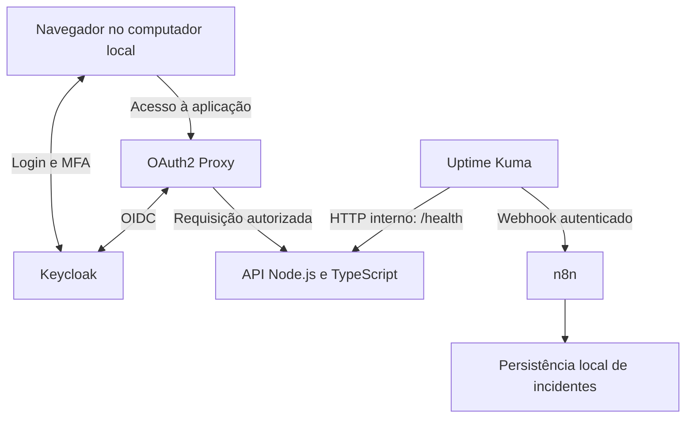

# Arquitetura do SecureOps Lab

> Status: Fundação Local concluída; Identidade em implementação (Keycloak e configuração do gateway, cadastro TOTP/autorização pendentes). Monitoramento e automação planejados. Este documento concentra decisões compartilhadas; detalhes executáveis ficam nas SPECS.

## 1. Restrições

- Execução no computador pessoal, com Docker Compose e containers Linux.
- Sem cloud, domínio, serviços pagos ou integrações externas obrigatórias em runtime.
- Downloads de imagens e dependências e o uso de IA no desenvolvimento podem exigir internet; isso não significa que a instalação inicial funcione offline.
- Apenas contas e dados fictícios; nenhuma conexão com sistemas corporativos.
- Escopo reduzido: um serviço protegido e um ciclo completo de incidente.

## 2. Componentes e fluxos



| Componente | Responsabilidade | Não deve fazer |
| --- | --- | --- |
| API | Representar o serviço interno e responder ao health check | Gerenciar credenciais ou executar recuperação privilegiada |
| OAuth2 Proxy | Validar sessão e aplicar autorização antes de encaminhar à API | Liberar acesso apenas porque o login funcionou |
| Keycloak | Autenticar identidades e exigir TOTP no fluxo definido | Ser apresentado como uma plataforma ZTNA completa |
| Uptime Kuma | Detectar disponibilidade interna e emitir eventos | Ser a única prova de funcionamento do acesso do usuário |
| n8n | Validar eventos e coordenar o ciclo de incidentes | Controlar o Docker ou executar ações privilegiadas |
| Persistência de incidentes | Manter estado consultável após reinícios | Ser confundida com o histórico temporário de execuções do n8n |

O armazenamento pode usar um recurso já disponível ou exigir um componente adicional. Essa escolha permanece aberta até a SPEC de automação; não adicionar um banco apenas por antecipação.

## 3. Acesso e identidade

Fluxo esperado:

1. O navegador solicita a aplicação pelo gateway.
2. Sem sessão válida, o gateway inicia autenticação OIDC no Keycloak.
3. O Keycloak autentica a conta e exige MFA com TOTP.
4. O gateway valida a resposta OIDC e a permissão por grupo ou claim.
5. A conta autorizada acessa a API; a conta sem permissão recebe negação.

Contas previstas: uma operadora autorizada e uma visitante autenticável, mas sem autorização. Ambas devem permitir comprovar a separação entre identidade e permissão.

A [SPEC 02](features/02-identity-access/SPEC.md) detalha realm, client, redirects, claims, autorização, cookies, logout e cadastro TOTP. Desenho aprovado; Keycloak executado, mas gateway só passou em teste de configuração. Não usar redirects amplos ou ignorar validações de emissor para contornar problemas de rede.

### Endereçamento OIDC

O navegador e o gateway em container precisam alcançar os endpoints do Keycloak mantendo coerência do emissor (`issuer`). `localhost` dentro de um container não aponta para o host nem para outro serviço.

A solução de nomes, hostname e descoberta OIDC deve ser definida e testada explicitamente na SPEC de identidade. Não basta trocar URLs até o login aparecer.

## 4. Rede e exposição

Topologia lógica proposta:

| Rede | Participantes | Finalidade |
| --- | --- | --- |
| Identidade | Gateway e Keycloak | Comunicação OIDC |
| Serviço | Gateway, API e monitor | Encaminhamento e health check |
| Eventos | Monitor e n8n | Entrega de webhooks |

A rede `identity` foi implementada como bridge **não interna**, após aprovação explícita D04: a tentativa interna suprimiu os bindings no host neste Docker. Somente os serviços de identidade ganham rota de saída; isso não comprova bloqueio de egress. `service` permanece `internal: true`, API somente nela e sem porta. Rede de eventos/participantes futuros continuam planejados. Não foi realizado teste de egress contra sistemas externos. Configuração e evidências ficam na [SPEC 02](features/02-identity-access/SPEC.md) e seu [registro](evidence/02-identity-access.md).

- A API não publica porta no host.
- Gateway, Keycloak e interfaces administrativas necessárias publicam portas somente em loopback.
- As portas exatas serão definidas após verificar conflitos no computador.
- O n8n não precisa ter seu webhook exposto na internet: o monitor o acessa pela rede Docker.
- Credenciais do webhook e painéis administrativos devem continuar protegidos mesmo em ambiente local.

A máquina hospedeira, seus administradores e o daemon Docker fazem parte da base de confiança. Ausência de porta publicada não é isolamento contra quem controla o host ou consegue entrar na rede Docker.

## 5. Transporte local

HTTP estritamente local, cookies sem Secure onde necessário e modo de desenvolvimento foram aprovados explicitamente na [SPEC 02](features/02-identity-access/SPEC.md), com riscos, limites e validações pendentes de navegador. A exceção inclui credenciais fictícias e cookies do Keycloak/gateway, sem desligar validações OIDC. A política SSL do realm continua `external`; qualquer redução exige nova aprovação específica.

A solução deve registrar URLs, confiança de certificados, comportamento dos cookies e eventuais exceções. Caso HTTP seja escolhido para a PoC, não apresentar o tráfego como cifrado, não usar credenciais reais e documentar o limite local. Não espalhar desativações de TLS ou de verificação de tokens como atalho.

## 6. Monitoramento e incidentes

O monitor consulta `/health` pela rede interna. Isso mede disponibilidade HTTP da API, não todo o caminho do usuário nem a saúde do provedor de identidade.

```text
API indisponível → monitor detecta → webhook → validação → incidente aberto
API recuperada  → monitor detecta → webhook → validação → incidente encerrado
```

Requisitos transversais para a SPEC de automação:

- Definir contrato a partir do payload real emitido pela versão escolhida do monitor.
- Validar autenticação e campos antes de modificar estado.
- Identificar o serviço e evitar incidentes abertos duplicados para a mesma falha.
- Definir comportamento para retries, eventos simultâneos, duplicados e fora de ordem.
- Não abrir incidentes a partir de notificações de recuperação isoladas.
- Persistir estado e tratar reinício do n8n sem perder a deduplicação.
- Registrar timestamps com referência de fuso e calcular duração observada, não duração exata da falha.
- Definir o que ocorre se a entrega do webhook ou a persistência falhar; não prometer entrega garantida sem mecanismo validado.

O monitor, o n8n e seu armazenamento devem sobreviver à parada isolada da API. Uma falha do próprio computador derruba o laboratório inteiro.

## 7. Dados, configuração e evidências

- Usar volumes nomeados para os dados que precisarem sobreviver a reinícios.
- Definir retenção e limpeza de logs e execuções nas respectivas SPECS.
- Manter segredos fora do controle de versão; arquivos de exemplo contêm somente placeholders.
- Proteger e manter estável a chave de criptografia do n8n quando usada para credenciais persistentes.
- Registrar evidências em `docs/evidence/` somente após sanitização.
- Não armazenar QR codes ou sementes TOTP, tokens, senhas ou conteúdo sensível em capturas e exports.
- Documentar separadamente parada de serviços, recriação de containers e exclusão de volumes.

Volumes não substituem backups e não garantem integridade ou auditoria imutável.

## 8. Decisões abertas e local de resolução

| Decisão | Resolver em |
| --- | --- |
| Fundação: versões, porta interna e rede definidas; execução validada e snapshot de consumo registrado | [SPEC 01 — Fundação local](features/01-local-foundation/SPEC.md) e [evidências](evidence/01-local-foundation.md) |
| D01–D04 aprovadas: transporte local, nomes OIDC, dev-file e rede de identidade; validação de login/MFA pendente | [SPEC 02 — Identidade e acesso](features/02-identity-access/SPEC.md) |
| Intervalos, retries e payload real de notificação | SPEC 03 — Monitoramento |
| Autenticação do webhook, armazenamento e consistência dos eventos | SPEC 04 — Automação de incidentes |

## 9. Limites da demonstração

O laboratório não implementa ZTNA completo, SSO entre várias aplicações, WAF, firewall corporativo, alta disponibilidade ou recuperação automática. WAF é uma extensão opcional, fora do caminho principal.

A comprovação exige testes positivos e negativos, reinícios e consulta do estado persistido. Diagrama, configuração escrita ou container iniciado não equivalem a controle validado.
